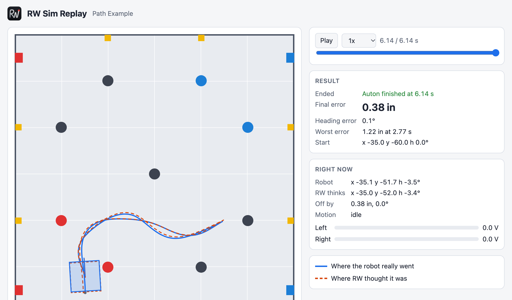

<p align="center">
  
</p>

<h1 align="center">RW-Template</h1>

<p align="center">
  <b>A VEX V5 autonomous template</b> with odometry, path following, MCL and a simulator.<br>
  Works with or without tracking wheels.
</p>

<p align="center">
  <a href="https://richardbwang.github.io/RW-Template/"><b>📘 Documentation</b></a> ·
  <a href="https://github.com/richardbwang/RW-Template/releases"><b>⬇️ Download</b></a> ·
  <a href="https://richardbwang.github.io/RW-Template/simulator/replays/"><b>▶️ Replay Gallery</b></a> ·
  <a href="https://discord.gg/9FHyyFe22p"><b>💬 Discord</b></a>
</p>

<p align="center">
  <a href="https://github.com/richardbwang/RW-Template/releases"></a>
  <a href="https://github.com/richardbwang/RW-Template/stargazers"></a>
  <a href="https://discord.gg/9FHyyFe22p"></a>
</p>

<p align="center">
  <a href="https://richardbwang.github.io/RW-Template/simulator/replays/"></a>
  <br><sub>The Path Example auton in the simulator. <a href="https://richardbwang.github.io/RW-Template/simulator/replays/">Watch it play</a>.</sub>
</p>

## 🚀 Features

- **Odometry** from drive encoders and/or tracking wheels plus the IMU, in any tracking wheel setup
- **Motions:** drive, turn and swing to a heading or point, arcs (`curveCircle`), move to point, boomerang to a pose, and motion chaining
- **Drive types:** tank, X-drive, mecanum and H-drive, with strafing motions (`strafeToPose()`, `strafe()`) and field-centric driver control
- **Async motions:** run a motion in the background and time mechanisms to it with `waitUntilTraveled()`, `waitUntilNear()` and `cancelMotion()`
- **Motion profiling:** `driveProfiled()` and `turnProfiled()` with a feedforward model of your drive
- **Path following:** smooth paths through waypoints or drawn in path.jerryio, with pure pursuit or RAMSETE
- **Distance resets and Monte Carlo Localization** to keep odometry from drifting
- **Simulator:** run your real autons on a computer, in VEXcode or PROS, and watch a replay on an Override field
- **Auton selector** on the Brain and controller, **driver curves**, a universal **PID class**, and a **stall exit**
- **Easy updates:** everything you change lives in `custom/`, and one VS Code task updates the rest

See the [features overview](https://richardbwang.github.io/RW-Template/) and [what's new](https://richardbwang.github.io/RW-Template/getting-started/whats-new/).

## ⚡ Quick Start

1. Install [VS Code](https://code.visualstudio.com/) and the **VEX Robotics Extension**
2. Download **`RW-Template.zip`** from [Releases](https://github.com/richardbwang/RW-Template/releases) (not "Source code"), unzip it, and open the folder in VS Code
3. Set your ports in `custom/src/robot-config.cpp`, and your wheel measurements as in [Tuning Your Robot](https://richardbwang.github.io/RW-Template/guide/tuning/)
4. Run the **Tuning Test** auton and tune the PID constants until it stops on target
5. Write your autons in `custom/src/autonomous.cpp`. [Which motion should I use?](https://richardbwang.github.io/RW-Template/guide/autonomous/#which-motion-should-i-use)

Updating? In VS Code's menu bar (top of the screen on a Mac), click **Terminal > Run Task... > Update RW-Template**. Your `custom` folder stays as it is. Projects from 4.0.0 and older [update by hand once](https://richardbwang.github.io/RW-Template/getting-started/installation/#projects-from-400-and-older).

Using PROS? Run these in your project's PROS terminal:

```
pros c add-depot RW-Template https://raw.githubusercontent.com/richardbwang/RW-Template/depot/stable.json
pros c apply RW-Template
```

See [Using PROS](https://richardbwang.github.io/RW-Template/getting-started/pros/) for the rest.

The full guide is on the **[documentation site](https://richardbwang.github.io/RW-Template/)**.

## 💬 Help

Ask on [our Discord](https://discord.gg/9FHyyFe22p) or [open an issue](https://github.com/richardbwang/RW-Template/issues).

## 🙏 Credits

Built on work by Team 5225A, 2654E, NlGanma, 1516X, jpearman, path.jerryio, LemLib, EZ-Template, JAR-Template, mikLib, mclib and others. See [Credits](https://richardbwang.github.io/RW-Template/credits/) for the full list, and thanks to everyone who has contributed on GitHub.

If you find this template useful, please star this repository and subscribe to [1698V on YouTube](https://www.youtube.com/@1698V) to follow the team's progress and learn more about our programming.
