---
hide:
  - navigation
  - toc
---

# RW-Template

**A VEX V5 autonomous template** focused on precise, algorithm-driven motion planning and control, for teams who want robust, adaptable autonomous routines on almost any sensor and drive setup.

[Get started](getting-started/installation.md){ .md-button .md-button--primary }
[Download](https://github.com/richardbwang/RW-Template/releases){ .md-button }

## See it drive

This is the template's [Path Example](guide/path-following.md) auton running in the [simulator](simulator/running.md): an S-curve with pure pursuit, then back along it with RAMSETE. Blue is where the robot really went, orange is where RW thought it was. Press **Play**.

## Features

-   :material-map-marker-path:{ .lg .middle } __Odometry, with or without tracking wheels__

    ---

    Tracks the robot's position from drive encoders and/or tracking wheels plus the IMU. All four setups share one tested implementation.

    [:octicons-arrow-right-24: Configuration](guide/configuration.md)

-   :material-vector-curve:{ .lg .middle } __Motions for every job__

    ---

    Drive, turn, swing, arc, move to point, boomerang to a pose, and chain them together without stopping.

    [:octicons-arrow-right-24: Which motion should I use?](guide/autonomous.md#which-motion-should-i-use)

-   :material-timer-sand:{ .lg .middle } __Async motions__

    ---

    Run a motion in the background and time mechanisms to it with `waitUntilTraveled()`, `waitUntilNear()` and `cancelMotion()`.

    [:octicons-arrow-right-24: Async motions](guide/async-motions.md)

-   :material-chart-bell-curve-cumulative:{ .lg .middle } __Motion profiling__

    ---

    `driveProfiled()` and `turnProfiled()` speed up, cruise and slow down smoothly using a feedforward model of your drive.

    [:octicons-arrow-right-24: Motion profiles](guide/motion-profiles.md)

-   :material-road-variant:{ .lg .middle } __Path following__

    ---

    Smooth paths through waypoints or drawn in path.jerryio, followed with pure pursuit or RAMSETE.

    [:octicons-arrow-right-24: Path following](guide/path-following.md)

-   :material-satellite-variant:{ .lg .middle } __Distance resets and MCL__

    ---

    Reset position off the walls, or let Monte Carlo Localization keep correcting odometry while you drive.

    [:octicons-arrow-right-24: Localization](guide/localization.md)

-   :material-monitor-dashboard:{ .lg .middle } __Simulator__

    ---

    Run your real autons on a computer and watch a replay on an Override field. No robot needed.

    [:octicons-arrow-right-24: Simulator](simulator/running.md)

-   :material-folder-lock-outline:{ .lg .middle } __Easy updates__

    ---

    Everything you change lives in `custom/`. One VS Code task updates the rest to the newest version.

    [:octicons-arrow-right-24: Updating](getting-started/installation.md)

Also included: a universal PID class, an auton selector on the Brain and controller, driver curves, IMU scale correction, and a stall exit for stuck motions.

## Questions?

Ask on [our Discord](https://discord.gg/9FHyyFe22p) or [open an issue](https://github.com/richardbwang/RW-Template/issues). Follow team 1698V on [YouTube](https://www.youtube.com/@1698V).
